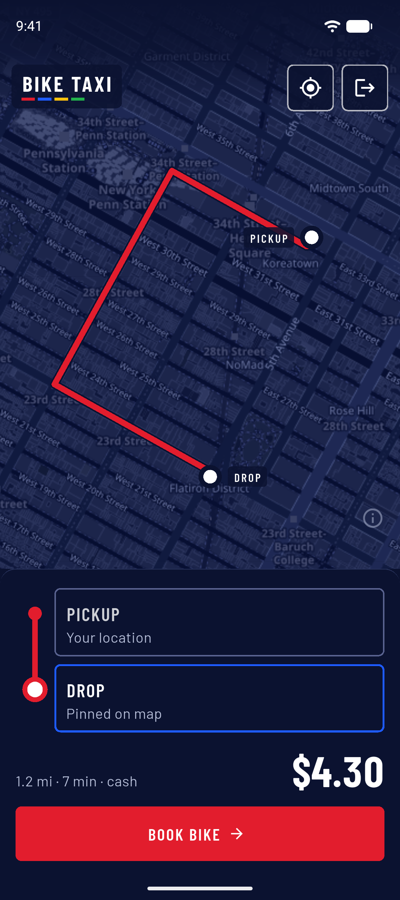
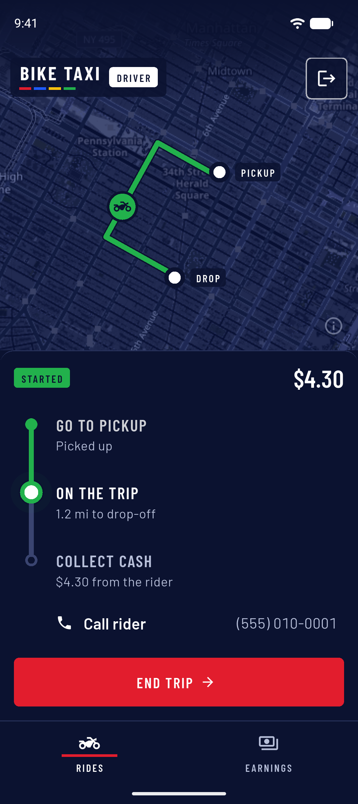
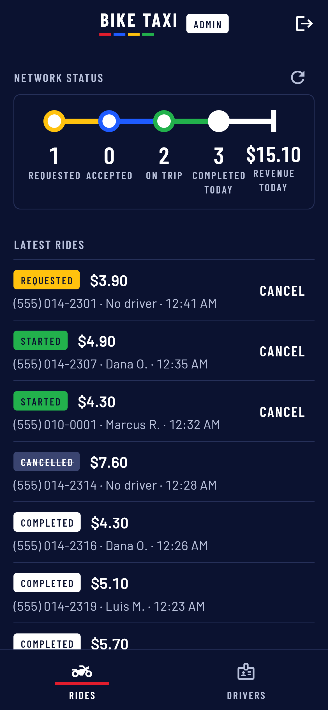
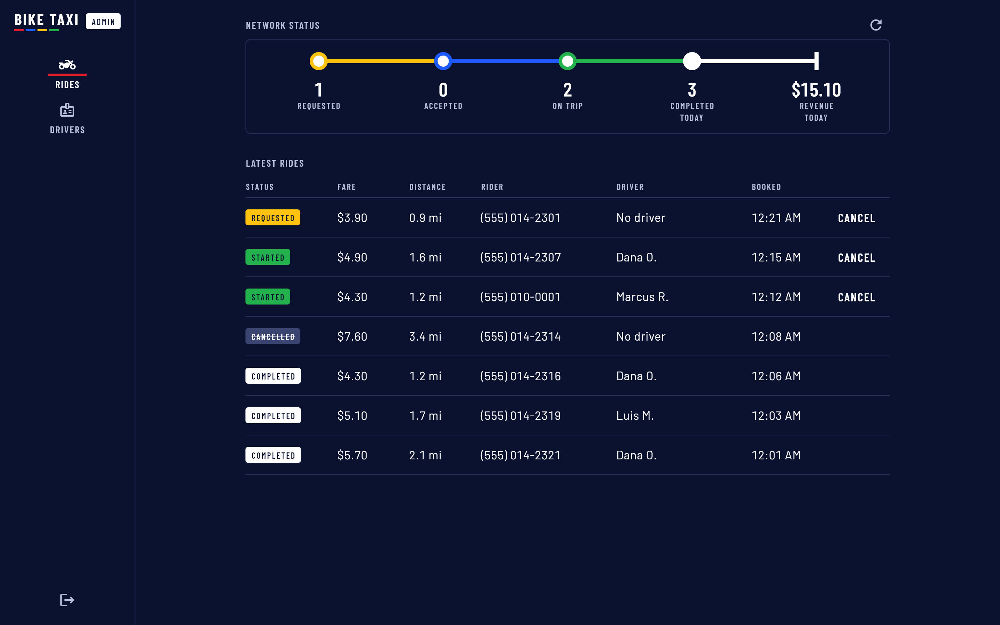

# Bike Taxi

A bike-only taxi MVP in Flutter. One codebase, three apps:

- **Customer** (Android, flavor `customer`): book a bike, see the fare, track the driver, cancel.
- **Driver** (Android, flavor `driver`): register, wait for approval, go online, accept, start, end, earnings.
- **Admin** (web): today's numbers, rides (cancel open ones), drivers (approve / block).

A portfolio demo: no real riders, drivers or trips are behind it, and the screenshots show sample data.

| Rider | Driver | Admin (phone) |
|---|---|---|
|  |  |  |



Built with Flutter, Firebase Auth (phone OTP), Cloud Firestore with tested security rules, flutter_map and OpenStreetMap, and Valhalla road routing.

Everyone signs in with a phone number and an SMS code. Fares are cash: `$2.50 + $1.50 per mile` on the road distance
(routed by Valhalla, see below).

## Flutter/Rust POC

Android builds now require Rust (`cargo`/`rustup` on PATH); Cargokit builds the
embedded crate automatically. Computation stays in Dart by default. Opt in with
`--dart-define=USE_RUST=true` on either Android flavor; Web always uses Dart.
See [architecture, tests and rollback](docs/flutter-rust-poc.md) and
[measured benchmarks](docs/flutter-rust-benchmarks.md). Client Rust does not replace
trusted server-side fare enforcement.

## 1. Run locally with the emulators

```sh
# The Firebase emulators need Java 21.
JAVA_HOME=/Library/Java/JavaVirtualMachines/temurin-21.jdk/Contents/Home firebase emulators:start

flutter run --flavor customer --dart-define=EMULATOR_HOST=10.0.2.2   # Android emulator
flutter run --flavor driver --dart-define=EMULATOR_HOST=10.0.2.2
flutter run -d chrome --dart-define=EMULATOR_HOST=localhost          # admin panel
```

No SMS is sent. Read the code in the emulator UI (http://localhost:4000, Auth tab) or with
`curl localhost:9099/emulator/v1/projects/demo-bike-taxi/verificationCodes`.

Rules test (starts its own Firestore emulator):

```sh
(cd rules-test && npm install)
JAVA_HOME=/Library/Java/JavaVirtualMachines/temurin-21.jdk/Contents/Home \
  firebase emulators:exec --only firestore --project demo-bike-taxi "node --test rules-test/"
```

### Road routing (Valhalla)

The rider app routes pickup to drop on a [Valhalla](https://github.com/valhalla/valhalla) server (motorcycle costing)
and prices the fare on the road distance. Run one locally with New York City data:

```sh
mkdir -p valhalla/custom_files && curl -L -o valhalla/custom_files/NewYork.osm.pbf https://download.bbbike.org/osm/bbbike/NewYork/NewYork.osm.pbf && docker run -dt --name valhalla -p 8002:8002 -v $PWD/valhalla/custom_files:/custom_files ghcr.io/valhalla/valhalla-scripted:latest
```

The apps use `--dart-define=VALHALLA_URL=...` when given, else `http://<EMULATOR_HOST>:8002` when
`EMULATOR_HOST` is set, else the public FOSSGIS server `https://valhalla1.openstreetmap.de`. The public
server is a free, rate-limited demo under a fair-use policy: fine for trying the app, not for real traffic.
Run your own Valhalla before launch.

## 2. Make an admin

Sign in on the admin panel; it shows your uid. Create the document `admins/<uid>` (no fields needed)
in the Firestore emulator UI, or in the Firebase console for a real project. The panel opens by itself.

## 3. Going live

1. Create a Firebase project and enable **Phone** sign-in (Authentication → Sign-in method).
2. Add Android apps `com.biketaxi.bike_taxi.customer` and `com.biketaxi.bike_taxi.driver` with their
   SHA-1 and SHA-256 fingerprints, and a web app.
3. Fill `lib/firebase_options.dart` with the real values and set the project id in `.firebaserc`.
4. `firebase deploy --only firestore` (rules and indexes).
5. Build the apps: `flutter build apk --flavor customer` and `flutter build apk --flavor driver`.
6. Admin: `flutter build web && firebase deploy --only hosting`.

Real SMS codes need the Blaze (pay-as-you-go) plan; test phone numbers (Authentication → Settings)
work without it.

## 4. Not in the MVP

- Address search: pickup and drop are set by tapping the map.
- Server-side routing: the rider app routes and prices the ride; the rules only check the distance
  is plausible for the pins and the fare follows the formula.
- Online payment: cash only.
- Push notifications: apps update while open.
- Background tracking: the driver's location is shared only while the app is in the foreground.
- Ratings.

## Licence

Code: [MIT](LICENSE). Barlow fonts: SIL OFL 1.1 ([assets/fonts/OFL.txt](assets/fonts/OFL.txt)). Map data © OpenStreetMap contributors.
